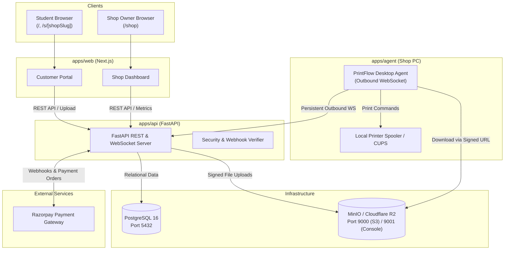

# PrintFlow

> Automated cloud-to-print ecosystem connecting students, campus print shops, and local printer hardware.

PrintFlow eliminates queues and friction at campus print shops. Students upload documents from their phone or laptop, configure print specifications (B/W vs. Colour, single vs. double-sided, copies), pay online, and the shop's computer automatically routes and prints the job via an outbound background agent.

---

## Architecture



---

## Monorepo Layout

```
printflow/
├── apps/
│   ├── web/          # Next.js 16 (App Router, Tailwind CSS, shadcn/ui)
│   ├── api/          # FastAPI backend (Python 3.12, SQLAlchemy 2.x, Alembic, uv)
│   └── agent/        # Shop desktop agent (Python 3.12, uv)
├── docs/             # Technical specifications (architecture, pricing, api)
├── infra/            # Docker Compose services (PostgreSQL 16, MinIO)
├── .github/          # GitHub Actions CI workflow
├── AGENTS.md         # Permanent project rules & operating procedures
├── README.md         # Setup and developer guide
├── .editorconfig     # Multi-editor style configuration
├── .gitignore        # Comprehensive git ignore rules
└── .env.example      # Master environment template
```

---

## Infrastructure Ports

| Service | Port | Description |
| :--- | :--- | :--- |
| **PostgreSQL 16** | `5432` | Primary relational database |
| **MinIO API** | `9000` | S3-compatible object storage API |
| **MinIO Console** | `9001` | Object storage web admin console (`http://localhost:9001`) |
| **FastAPI** | `8000` | Backend API server |
| **Next.js Web** | `3000` | Frontend web application |

---

## Prerequisites

- **Git** (`>= 2.40`)
- **Node.js** (`>= 20.0.0`)
- **pnpm** (`>= 10.0.0`)
- **uv** (`>= 0.5.0`) & Python 3.12 managed via `uv` (`uv python install 3.12`)
- **Docker** & **Docker Compose v2** (running via Docker Desktop or OrbStack)

---

## Getting Started

### 1. Copy Environment Configuration Files

Copy the provided `.env.example` templates to `.env`:

```bash
# Root environment (used by Docker Compose)
cp .env.example .env

# Web application
cp apps/web/.env.example apps/web/.env

# API service
cp apps/api/.env.example apps/api/.env

# Shop agent
cp apps/agent/.env.example apps/agent/.env
```

### 2. Start Infrastructure Containers

Start PostgreSQL and MinIO using Docker Compose:

```bash
docker compose -f infra/docker-compose.yml up -d
```

Verify that both containers are running and healthy:

```bash
docker compose -f infra/docker-compose.yml ps
```

### 3. Run the API Service (`apps/api`)

In a new terminal:

```bash
cd apps/api

# Sync Python 3.12 dependencies
uv sync

# Run database migrations
uv run alembic upgrade head

# Start FastAPI development server
uv run uvicorn app.main:app --reload --host 0.0.0.0 --port 8000
```

Verify health check:
```bash
curl http://localhost:8000/health
# Expected: {"status":"ok"}
```

### 4. Run the Web Application (`apps/web`)

In a new terminal:

```bash
cd apps/web

# Install dependencies
pnpm install

# Start Next.js development server
pnpm dev
```

Visit the routes in your browser:
- `http://localhost:3000` - Customer Landing Page
- `http://localhost:3000/s/campus-hub` - Customer Shop Page
- `http://localhost:3000/shop` - Shop Dashboard

### 5. Run the Shop Agent (`apps/agent`)

In a new terminal:

```bash
cd apps/agent

# Sync Python 3.12 dependencies
uv sync

# Run CLI agent with example config
uv run python -m app.main --config config.example.json
```

---

## Running Linters & Tests

### API
```bash
cd apps/api
uv run ruff check .
uv run ruff format --check .
uv run pytest
```

### Web
```bash
cd apps/web
pnpm lint
pnpm typecheck
pnpm format:check
pnpm build
```

### Agent
```bash
cd apps/agent
uv run ruff check .
uv run ruff format --check .
uv run pytest
```

---

## Order Lifecycle States

Orders progress through the following deterministic states:
`uploaded` &rarr; `awaiting_payment` &rarr; `paid` &rarr; `queued` &rarr; `printing` &rarr; `ready` &rarr; `collected` (alongside terminal exception states: `failed`, `refunded`, `cancelled`).
